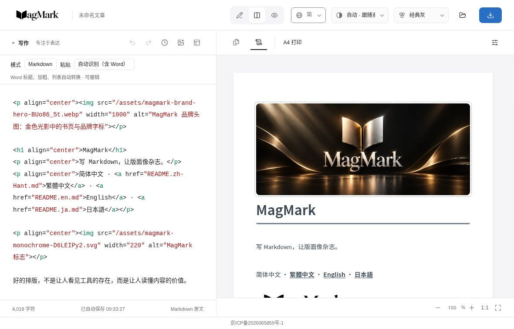

# jammyfu / PaintingCoder

**使えるツール、遊べるゲーム、再利用できる AI ワークフローを作る。**

[English](README.md) · [简体中文](README.zh-CN.md) · [繁體中文](README.zh-TW.md) · [日本語](README.ja.md) · [한국어](README.ko.md)

| プレビュー | プロジェクトと実装 |
| --- | --- |
| **[Open Game Skills · PunchBox Fighter](https://github.com/jammyfu/open-game-skills)**   | **スキルを説明するだけでなく、ゲームで示す。** · スキル集 + ゲーム例 Agent Skills · Python · ゲーム開発ワークフロー [コード](https://github.com/jammyfu/open-game-skills/tree/main/skills) |
| **[The Legend of Trump · 白宫奇遇记](https://github.com/jammyfu/TheLegendOfTrump)**  ローカル作業版・実機の戦闘 | **世界づくりから戦闘まで、遊べるブラウザー冒険ゲームに。** · 非公式の独立ゲーム React · TypeScript · Three.js / R3F · WebGL [コード](https://github.com/jammyfu/TheLegendOfTrump/tree/main/src/game) |
| **[MagMark](https://github.com/jammyfu/MagMark)**  | **Markdown を実際に使える誌面へ。** · 組版エディター・ベータ版 TypeScript · エディター UX · 描画と書き出し [コード](https://github.com/jammyfu/MagMark/tree/main/src) |
| **[Xiangsheng Genealogy · 相声家谱](https://github.com/jammyfu/xiangsheng-genealogy)**  | **文化資料を探索できるインタラクティブ作品へ。** · インタラクティブ可視化 React · Three.js · TypeScript · 構造化データ [コード](https://github.com/jammyfu/xiangsheng-genealogy/tree/main/data) |
| **[ComfyUI PaintingCoderUtils](https://github.com/jammyfu/ComfyUI_PaintingCoderUtils)**  | **創作の繰り返し作業を減らす小さなツール。** · AI ワークフロー統合 Python · 画像ワークフロー · 統合の使いやすさ [コード](https://github.com/jammyfu/ComfyUI_PaintingCoderUtils/tree/main/workflow) |

[**すべてのプロジェクト →**](https://github.com/jammyfu?tab=repositories)
