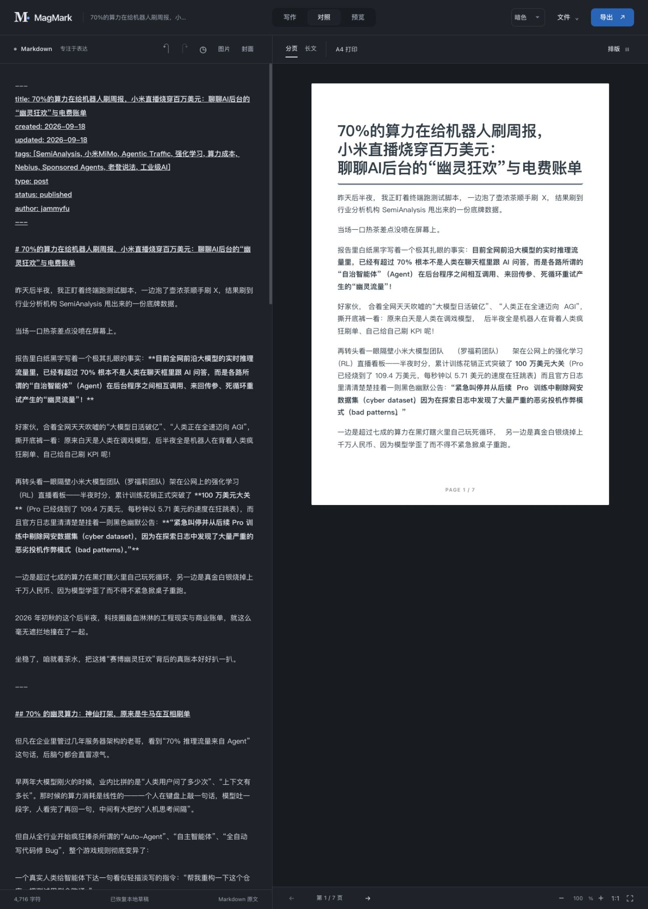
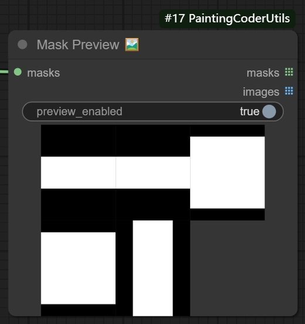

# jammyfu / PaintingCoder

**AI ツール、エージェントのワークフロー、創作ソフトウェア。**

[English](README.md) · [简体中文](README.zh-CN.md) · [繁體中文](README.zh-TW.md) · [日本語](README.ja.md) · [한국어](README.ko.md)

アイデアを、確認・実行・利用できる形にする実用的なツールを開発しています。公開プロジェクトは AI を活用したゲーム開発、組版、ComfyUI のワークフロー、オープンソース探索が中心です。

[↓ 主なプロジェクト](#selected-work) · [GitHub](https://github.com/jammyfu?tab=repositories)

## 主なプロジェクト

### [Open Game Skills](https://github.com/jammyfu/open-game-skills)

**プロンプト集ではなく、再利用できる開発手順。**

ゲーム開発のタスクに応じて専門スキルとエンジンアダプターを選択します。公開されている自転車に乗るペリカンの例では、レイヤー画像、ボーン、逆運動学、スキニングを検証可能なアニメーションにつなげています。

`エージェント連携 · Python ツール · 再現可能な例`

[→ ソースと実例を見る](https://github.com/jammyfu/open-game-skills) · [実装の確認](https://github.com/jammyfu/open-game-skills/tree/main/examples/pelican-bicycle)

### [MagMark](https://github.com/jammyfu/MagMark)

**Markdown を実際に使える誌面へ。**

中国語と欧文の混植に対応するブラウザーエディター。ページプレビュー、PNG、印刷 / PDF、WeChat 向けリッチテキストの出力経路と制約を分けています。現在はベータ版で、利用環境と公開先での確認が必要です。

`TypeScript · エディター UX · 描画と書き出し`

[→ ソースと実例を見る](https://github.com/jammyfu/MagMark) · [実装の確認](https://github.com/jammyfu/MagMark/tree/main/tests)

### [ComfyUI PaintingCoderUtils](https://github.com/jammyfu/ComfyUI_PaintingCoderUtils)

**創作の繰り返し作業を減らす小さなツール。**

画像サイズ、テキスト整形、マスク、ワークフロー修復用の ComfyUI カスタムノード。画像だけでなく、サンプル JSON と移行用修復ツールを提供します。

`Python · 画像ワークフロー · 統合の使いやすさ`

[→ ソースと実例を見る](https://github.com/jammyfu/ComfyUI_PaintingCoderUtils) · [実装の確認](https://github.com/jammyfu/ComfyUI_PaintingCoderUtils/tree/main/workflow)

*実際のプロジェクト画像です。生成した製品モックアップではありません。MagMark の画像は全言語で中国語の実画面を使用しています。*

## その他：探索と技術調査

- **[GitHub Risers](https://github.com/jammyfu/github-risers)** — 1 日当たりの Star 増加で探すランキング。計算規則、履歴、多言語出力を公開。
- **[Reverse Engineering Atlas](https://github.com/jammyfu/reverse-engineering-atlas)** — 技術とプラットフォーム別に整理したリバースエンジニアリング資料。出典と能力の限界を明記。
- **[Awesome AI Model Showcases](https://github.com/jammyfu/awesome-ai-model-showcases)** — 出典付きの AI 作品ギャラリー。ここでの取り組みはカタログと閲覧体験の構築であり、掲載作品は各作者に帰属します。

## 取り組みを確認するには

動く例から、ソース、テスト、既知の制約へ進んでください。製品の使い方、実装、わかりやすい説明をつなぎ、他の人が使い続け、改善できる形を大切にしています。

[**すべてのリポジトリを見る →**](https://github.com/jammyfu?tab=repositories)
