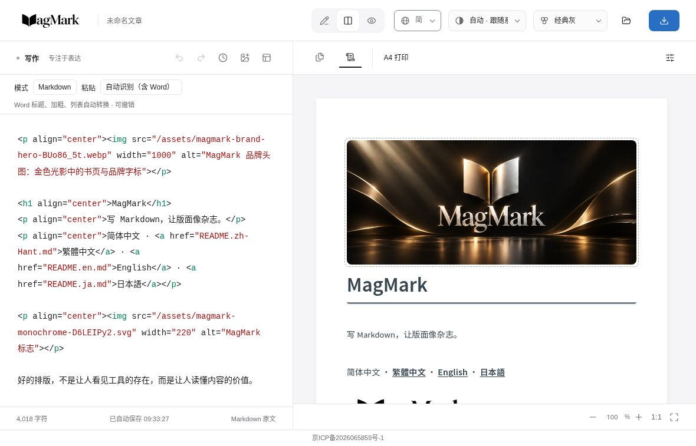

# jammyfu / PaintingCoder

**쓸 수 있는 도구, 즐길 수 있는 게임, 재사용할 수 있는 AI 워크플로를 만듭니다.**

[English](README.md) · [简体中文](README.zh-CN.md) · [繁體中文](README.zh-TW.md) · [日本語](README.ja.md) · [한국어](README.ko.md)

아이디어를 직접 살펴보고 실행하며 사용할 수 있는 도구로 만듭니다. 공개 프로젝트는 AI 기반 게임 개발, 출판용 편집, ComfyUI 워크플로, 오픈 소스 탐색을 다룹니다.

[↓ 대표 작품](#selected-work) · [↓ 다른 공개 프로젝트](#public-projects)

## 대표 작품

| 미리 보기 | 프로젝트 및 구현 |
| --- | --- |
|   | **[Open Game Skills · PunchBox Fighter](https://github.com/jammyfu/open-game-skills)**  **스킬 설명을 넘어, 게임 결과로 보여 주는 워크플로.** · 스킬 모음 + 게임 예제  개발 작업에 따라 전문 스킬과 엔진 어댑터를 선택합니다. 공개 예제인 PunchBox Fighter는 히트스톱, 카운터, 콤보 피드백, 피니시 연출을 보여 줍니다. 애니메이션과 리깅 예제도 포함한 재사용 가능한 스킬 모음이며 게임 엔진은 아닙니다.  Agent Skills · Python · 게임 개발 워크플로  [**프로젝트 보기 →**](https://github.com/jammyfu/open-game-skills) · [구현 보기](https://github.com/jammyfu/open-game-skills/tree/main/skills) |
|  | **[The Legend of Trump · 白宫奇遇记](https://github.com/jammyfu/TheLegendOfTrump)**  **세계 구현부터 전투까지, 직접 플레이하는 브라우저 모험 게임.** · 앱 / 플레이 가능한 프로젝트  AI 협업으로 개발한 로우 폴리 3D 모험 게임입니다. 탐험, 검·방패·활 전투, 적 행동, 보스전, 키보드·마우스와 터치 입력을 구현했습니다. 공개 저장소에서 시뮬레이션, UI, 에셋, 브라우저 테스트를 확인할 수 있습니다. 공식 라이선스 리메이크가 아닌 독립 비공식 작품입니다.  React · TypeScript · Three.js / R3F · WebGL  [**프로젝트 보기 →**](https://github.com/jammyfu/TheLegendOfTrump) · [구현 보기](https://github.com/jammyfu/TheLegendOfTrump/tree/main/src/game) |
|  | **[MagMark](https://github.com/jammyfu/MagMark)**  **Markdown을 실제로 활용할 수 있는 지면으로.** · 앱 / 플레이 가능한 프로젝트  중국어와 영문 혼합 조판을 위한 브라우저 편집기입니다. 페이지 미리 보기, PNG, 인쇄 / PDF, 위챗 서식 있는 텍스트의 출력 경로와 제약을 구분합니다. 현재 베타 버전으로 대상 브라우저와 게시 환경에서 확인이 필요합니다.  TypeScript · 편집기 UX · 렌더링과 내보내기  [**프로젝트 보기 →**](https://github.com/jammyfu/MagMark) · [구현 보기](https://github.com/jammyfu/MagMark/tree/main/src) |
|  | **[Xiangsheng Genealogy · 相声家谱](https://github.com/jammyfu/xiangsheng-genealogy)**  **문화 자료를 탐색할 수 있는 인터랙티브 작품으로.** · 인터랙티브 시각화  수묵화 두루마리, 3D 사제 관계, 검색과 인물 정보를 구조화된 인물·관계·출처 데이터에 연결합니다. 논쟁이 있는 관계는 별도로 표시하며 자료 정리를 확정된 역사적 사실로 제시하지 않습니다.  React · Three.js · TypeScript · 구조화 데이터  [**프로젝트 보기 →**](https://github.com/jammyfu/xiangsheng-genealogy) · [구현 보기](https://github.com/jammyfu/xiangsheng-genealogy/tree/main/data) |
|  | **[ComfyUI PaintingCoderUtils](https://github.com/jammyfu/ComfyUI_PaintingCoderUtils)**  **창작 과정의 반복 작업을 줄이는 작은 도구.** · AI 워크플로 통합  이미지 크기, 텍스트 정리, 마스크, 워크플로 복구를 위한 ComfyUI 사용자 정의 노드입니다. 화면 이미지뿐 아니라 예제 JSON과 버전 이전용 복구 도구를 제공합니다.  Python · 이미지 워크플로 · 통합 사용성  [**프로젝트 보기 →**](https://github.com/jammyfu/ComfyUI_PaintingCoderUtils) · [구현 보기](https://github.com/jammyfu/ComfyUI_PaintingCoderUtils/tree/main/workflow) |

실제 실행 화면과 녹화된 예제입니다. UI는 원래 언어를 유지하며 이미지를 누르면 원본을 볼 수 있습니다.

## 다른 공개 프로젝트

앱, 게임, 재사용 가능한 스킬, 조사 목록을 구분하여 각 작업의 가치와 범위를 보여 줍니다.

| 프로젝트 | 보여 주는 역량 / 현재 범위 |
| --- | --- |
| [github-risers](https://github.com/jammyfu/github-risers) | 하루당 Star 증가량으로 프로젝트를 찾습니다. 계산 규칙, 기록, 다국어 결과를 공개합니다. |
| [reverse-engineering-atlas](https://github.com/jammyfu/reverse-engineering-atlas) | 기술과 플랫폼별 역공학 자료를 정리하고 출처와 기능의 한계를 명시합니다. |
| [awesome-ai-model-showcases](https://github.com/jammyfu/awesome-ai-model-showcases) | 출처를 확인할 수 있는 AI 작품 갤러리입니다. 이 프로젝트의 기여는 목록과 탐색 경험 구축이며, 수록 작품은 명시된 제작자에게 귀속됩니다. |
| [TokenSpeedSimulator](https://github.com/jammyfu/TokenSpeedSimulator) | 브라우저 A/B 텍스트 재생으로 tokens/s를 체감하게 합니다. 실제 모델 벤치마크가 아닌 시뮬레이터입니다. |
| [bitmap-vector-studio](https://github.com/jammyfu/bitmap-vector-studio) | VTracer 기반 비트맵·벡터 변환 도구로 데스크톱, CLI, API를 연결합니다. 자체 트레이싱 엔진은 아닙니다. |
| [local-tool-skill](https://github.com/jammyfu/local-tool-skill) | 로컬 브라우저 도구를 위한 Agent Skill과 TypeScript 템플릿. 증명사진 크기와 인쇄 배치 흐름을 포함합니다. |
| [llm_gpu_toolkit](https://github.com/jammyfu/llm_gpu_toolkit) | Ollama 모델 자료와 대략적인 GPU 메모리 추정. 선택을 위한 참고이며 하드웨어 실측은 아닙니다. |
| [hf-download-list](https://github.com/jammyfu/hf-download-list) | CLI와 웹 UI로 Hugging Face 모델 파일 URL을 나열합니다. 모델 가중치를 직접 내려받지는 않습니다. |
| [MiiAIPlaza](https://github.com/jammyfu/MiiAIPlaza) | 기존 Mii 편집기를 확장한 AI 에이전트 광장 실험. mock / fixture 미리 보기이며 온라인 멀티플레이 서비스가 아닙니다. |
| [photo-spec-library](https://github.com/jammyfu/photo-spec-library) | 출처가 있는 증명사진 규격을 JSON과 Schema로 정리합니다. 명시되지 않은 값은 비워 두며 심사 통과를 보장하지 않습니다. |
| [awesome-game-assets](https://github.com/jammyfu/awesome-game-assets) | 원본 미리 보기, 용도, 라이선스 안내로 게임 에셋을 정리합니다. 수록 작품은 각 제작자에게 귀속됩니다. |
| [practical-oss](https://github.com/jammyfu/practical-oss) | 용도, 워크플로 내 역할, 라이선스를 정리하는 오픈 소스 조사. 수록 도구의 제작자임을 주장하지 않습니다. |

[**공개 포트폴리오 →**](https://github.com/jammyfu?tab=repositories)
