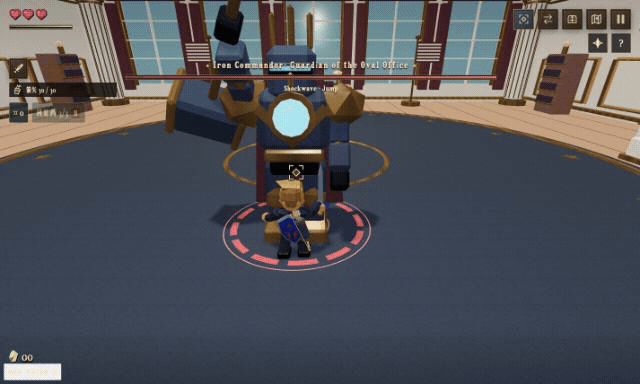

# jammyfu / PaintingCoder

**I build tools you can use, games you can play, and workflows you can reuse.**

[English](README.md) · [简体中文](README.zh-CN.md) · [繁體中文](README.zh-TW.md) · [日本語](README.ja.md) · [한국어](README.ko.md)

| Preview | Project & implementation |
| --- | --- |
| **[Open Game Skills · PunchBox Fighter](https://github.com/jammyfu/open-game-skills)**   | **From reusable agent skills to a fighting-game result.** · Skill pack + example game Agent Skills · Python · game-development workflows [Code](https://github.com/jammyfu/open-game-skills/tree/main/skills) |
| **[The Legend of Trump · 白宫奇遇记](https://github.com/jammyfu/TheLegendOfTrump)**  Local working build · 6s combat GIF | **A browser adventure, from world-building to combat.** · Independent unofficial game React · TypeScript · Three.js / R3F · WebGL [Code](https://github.com/jammyfu/TheLegendOfTrump/tree/main/src/game) |
| **[MagMark](https://github.com/jammyfu/MagMark)**  | **From Markdown to a usable publication.** · Publishing editor · beta TypeScript · editor UX · rendering and export [Code](https://github.com/jammyfu/MagMark/tree/main/src) |
| **[Xiangsheng Genealogy · 相声家谱](https://github.com/jammyfu/xiangsheng-genealogy)**  | **Make a cultural dataset feel explorable.** · Interactive visualization React · Three.js · TypeScript · structured data [Code](https://github.com/jammyfu/xiangsheng-genealogy/tree/main/data) |
| **[ComfyUI PaintingCoderUtils](https://github.com/jammyfu/ComfyUI_PaintingCoderUtils)**  | **Small tools that remove friction from creative work.** · AI workflow integration Python · image workflows · integration ergonomics [Code](https://github.com/jammyfu/ComfyUI_PaintingCoderUtils/tree/main/workflow) |

[**All projects →**](https://github.com/jammyfu?tab=repositories)
