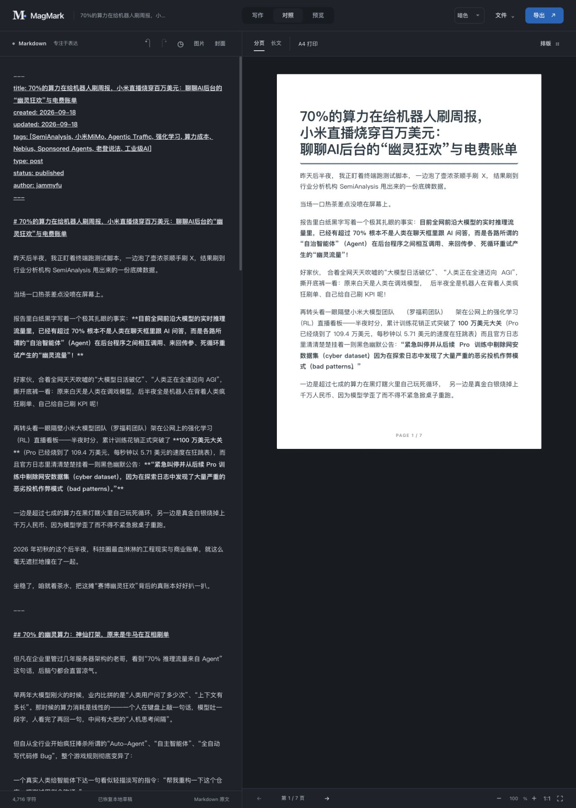
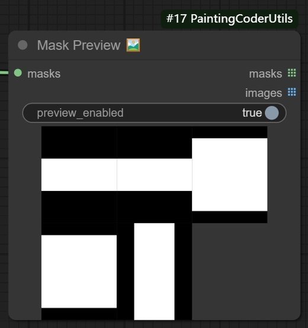

# jammyfu / PaintingCoder

**让 AI、工具和创意，变成能用的产品。**

[English](README.md) · [简体中文](README.zh-CN.md) · [繁體中文](README.zh-TW.md) · [日本語](README.ja.md) · [한국어](README.ko.md)

我围绕真实任务构建工具：把想法变成可查看、可运行、可使用的成果。公开项目覆盖 AI 辅助游戏开发、内容排版、ComfyUI 工作流与开源发现。

[↓ 精选项目](#selected-work) · [GitHub](https://github.com/jammyfu?tab=repositories)

## 精选项目

### [Open Game Skills](https://github.com/jammyfu/open-game-skills)

**把游戏开发经验变成可复用的 Agent 工作流。**

按任务调度专业技能与引擎适配器。公开的骑车鹈鹕案例将分层美术、骨骼、逆向运动学与蒙皮权重串成可检查的动画实现。

`Agent 编排 · Python 工具链 · 可复现案例`

[→ 查看源码与案例](https://github.com/jammyfu/open-game-skills) · [查看实现证据](https://github.com/jammyfu/open-game-skills/tree/main/examples/pelican-bicycle)

### [MagMark](https://github.com/jammyfu/MagMark)

**不止预览 Markdown，而是交付可用版面。**

面向中文与中英混排的浏览器编辑器，提供分页预览、PNG、打印 / PDF 与公众号富文本。不同输出路径明确区分限制。目前仍是 beta，目标浏览器和发布环节需要验收。

`TypeScript · 编辑器体验 · 渲染与导出`

[→ 查看源码与案例](https://github.com/jammyfu/MagMark) · [查看实现证据](https://github.com/jammyfu/MagMark/tree/main/tests)

### [ComfyUI PaintingCoderUtils](https://github.com/jammyfu/ComfyUI_PaintingCoderUtils)

**用小工具消除创作流程里的重复劳动。**

为 ComfyUI 提供图像尺寸、文本清理、遮罩与工作流修复节点；附带工作流 JSON 和迁移修复工具，不只展示效果图。

`Python · 图像工作流 · 集成体验`

[→ 查看源码与案例](https://github.com/jammyfu/ComfyUI_PaintingCoderUtils) · [查看实现证据](https://github.com/jammyfu/ComfyUI_PaintingCoderUtils/tree/main/workflow)

*图片来自真实项目，并非生成的产品效果图。五个语言版本保留 MagMark 的中文原始界面。*

## 更多项目：开源发现与技术研究

- **[GitHub Risers](https://github.com/jammyfu/github-risers)** — 按每日新增 Star 发现项目，公开计算规则、历史快照与多语言结果。
- **[Reverse Engineering Atlas](https://github.com/jammyfu/reverse-engineering-atlas)** — 按技术和平台组织跨平台逆向研究，保留来源与能力边界。
- **[Awesome AI Model Showcases](https://github.com/jammyfu/awesome-ai-model-showcases)** — 可追溯来源的 AI 作品展厅。这里体现的是目录整理与浏览体验建设，收录作品归署名创作者所有。

## 如何了解我的工作方式

先看一个实际案例，再查看源码、测试与已知限制。这些项目体现的是将产品流程、技术实现和清晰表达连起来的能力，不代表已经验证商业规模，也不声称独立创作了所有依赖。

[**查看全部仓库 →**](https://github.com/jammyfu?tab=repositories)

这里是公开项目作品集，不是雇佣经历证明。
