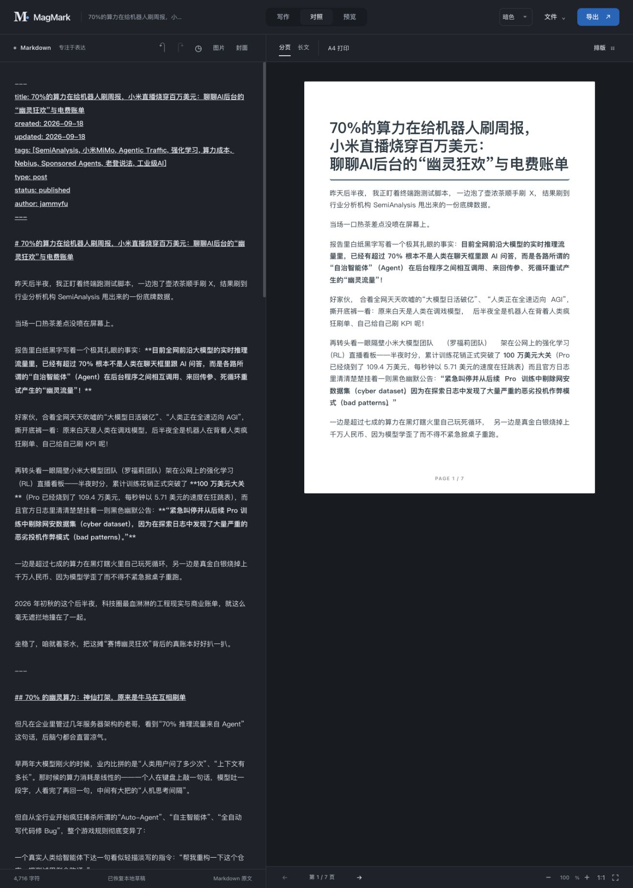
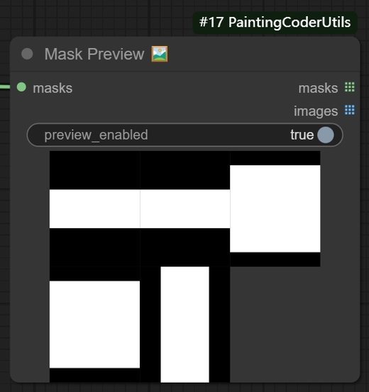

# jammyfu / PaintingCoder

**讓 AI、工具與創意，成為真正能用的產品。**

[English](README.md) · [简体中文](README.zh-CN.md) · [繁體中文](README.zh-TW.md) · [日本語](README.ja.md) · [한국어](README.ko.md)

我從實際需求出發製作工具，把想法轉為能檢視、能執行、能使用的成果。公開專案涵蓋 AI 輔助遊戲開發、內容排版、ComfyUI 工作流程與開源探索。

[↓ 精選專案](#selected-work) · [GitHub](https://github.com/jammyfu?tab=repositories)

## 精選專案

### [Open Game Skills](https://github.com/jammyfu/open-game-skills)

**將遊戲開發經驗整理成可重用的 Agent 工作流程。**

依任務調度專業技能與遊戲引擎介接。公開的騎車鵜鶘範例將分層美術、骨架、反向運動學與蒙皮權重串接成可檢視的動畫實作。

`Agent 協作流程 · Python 工具鏈 · 可重現範例`

[→ 查看原始碼與範例](https://github.com/jammyfu/open-game-skills) · [查看實作證據](https://github.com/jammyfu/open-game-skills/tree/main/examples/pelican-bicycle)

### [MagMark](https://github.com/jammyfu/MagMark)

**不只是預覽 Markdown，而是產出可用版面。**

針對中文與中英混排的瀏覽器編輯器，提供分頁預覽、PNG、列印 / PDF 與微信公眾號格式化文字。各種輸出方式分別說明限制。目前仍為 beta，須在目標瀏覽器與發布環境驗證。

`TypeScript · 編輯器使用體驗 · 算繪與匯出`

[→ 查看原始碼與範例](https://github.com/jammyfu/MagMark) · [查看實作證據](https://github.com/jammyfu/MagMark/tree/main/tests)

### [ComfyUI PaintingCoderUtils](https://github.com/jammyfu/ComfyUI_PaintingCoderUtils)

**用小工具減少創作流程中的重複作業。**

為 ComfyUI 提供影像尺寸、文字清理、遮罩與工作流程修復節點；附有工作流程 JSON 與版本遷移修復工具，不只是展示圖片。

`Python · 影像工作流程 · 整合體驗`

[→ 查看原始碼與範例](https://github.com/jammyfu/ComfyUI_PaintingCoderUtils) · [查看實作證據](https://github.com/jammyfu/ComfyUI_PaintingCoderUtils/tree/main/workflow)

*圖片來自實際專案，並非生成的產品示意圖。五種語言版本均保留 MagMark 原有的簡體中文介面。*

## 更多專案：開源探索與技術研究

- **[GitHub Risers](https://github.com/jammyfu/github-risers)** — 依每日新增 Star 探索專案，提供計算規則、歷史快照與多語內容。
- **[Reverse Engineering Atlas](https://github.com/jammyfu/reverse-engineering-atlas)** — 依技術與平台整理跨平台逆向工程研究，保留來源與能力限制。
- **[Awesome AI Model Showcases](https://github.com/jammyfu/awesome-ai-model-showcases)** — 可追溯來源的 AI 作品集。這裡呈現的是目錄整理與瀏覽體驗，收錄作品屬於各自署名的創作者。

## 如何了解我的工作方式

先看實際範例，再檢視原始碼、測試與已知限制。這些專案呈現將產品流程、技術實作與清楚表達串接起來的能力；不代表已驗證商業規模，也不宣稱所有相依元件皆為獨立創作。

[**查看所有儲存庫 →**](https://github.com/jammyfu?tab=repositories)

這是公開專案作品集，不是任職經歷證明。
